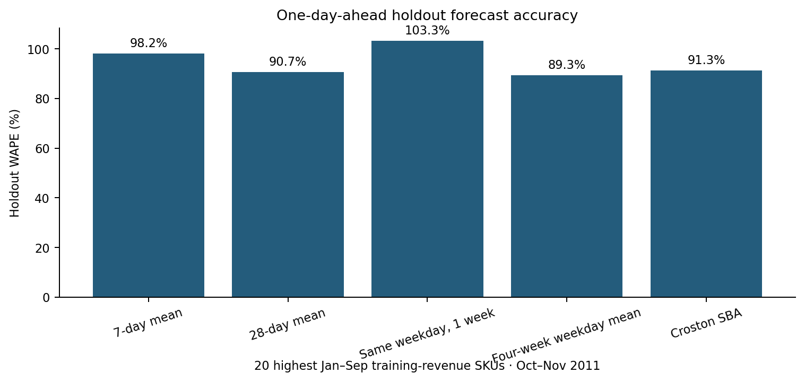
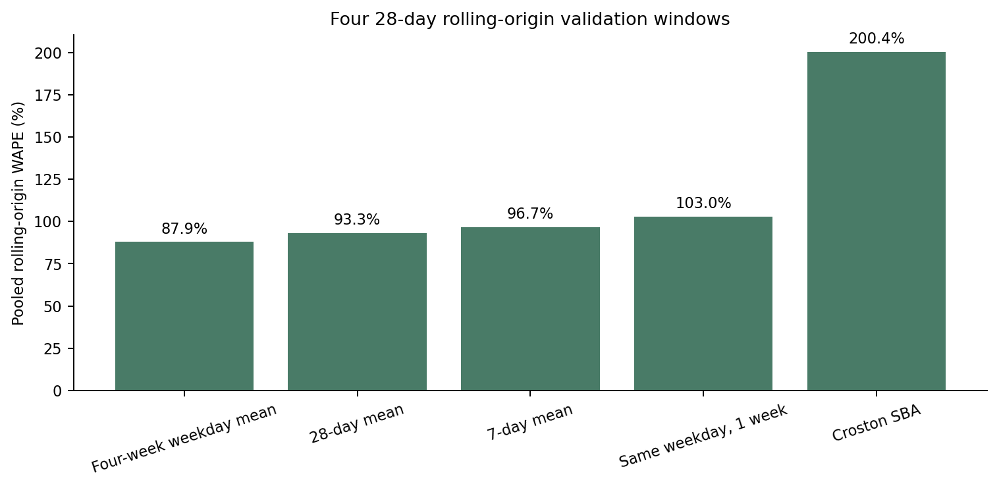
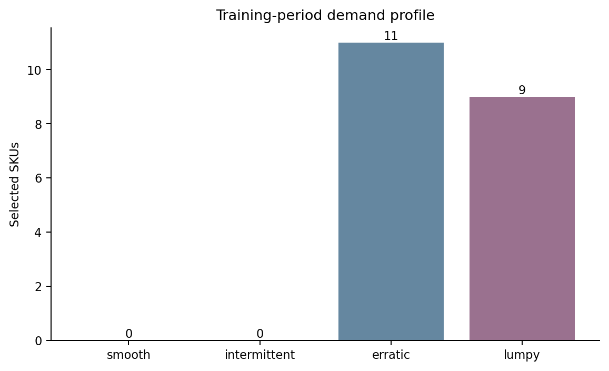
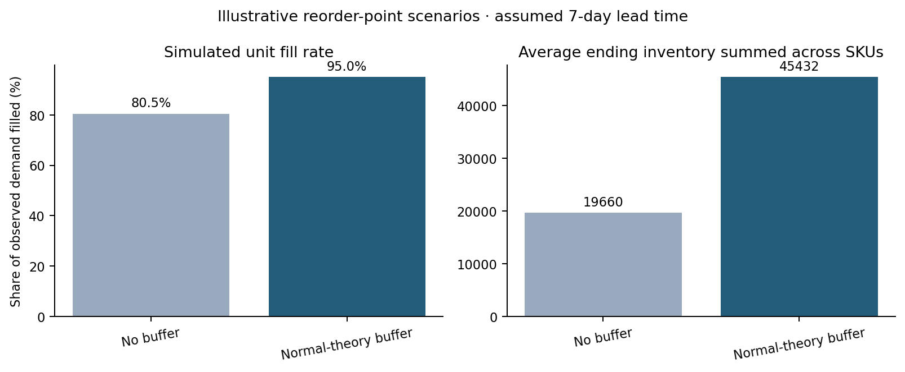
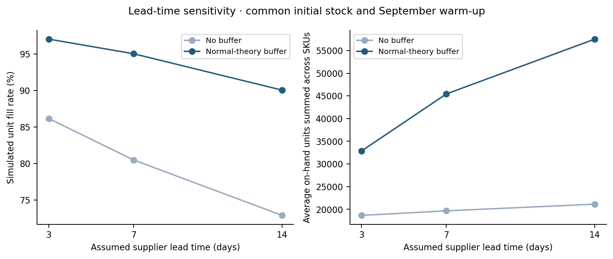
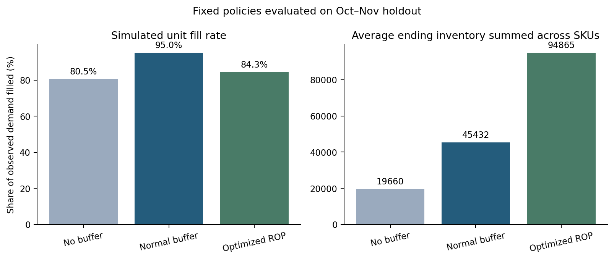

# Demand-to-Replenishment Planning Engine

An applied demand-planning project using the [UCI Online Retail dataset](https://archive.ics.uci.edu/dataset/352/online+retail) (Chen, 2015; DOI: 10.24432/C5BW33; CC BY 4.0). The source contains sales transactions. It does **not** contain unconstrained demand, inventory on hand, stockouts, supplier lead times, purchase costs, or order histories. Inventory outputs are illustrative simulations using stated assumptions; they are not retailer results or verified savings.

The project screens merchandise-like SKUs, compares daily forecasts, classifies demand behavior, evaluates reorder-point scenarios, and chooses a candidate reorder point using a historical validation period. The full workflow is in [`analysis.py`](analysis.py); a guided notebook is [`Inventory_Project.ipynb`](Inventory_Project.ipynb).

## Data and scope

The reproducible run read 541,909 source rows and retained 461,385 transaction lines dated January–November 2011 after filtering to positive quantity and price, non-cancelled invoices, and stock codes matching five digits plus up to two letters. It found 3,709 eligible SKUs across the full window; 3,538 had January–September sales and were eligible for ranking. The 20 SKUs with the highest January–September selling revenue were selected before the October–November holdout. ABC labels are based on cumulative selling revenue, not inventory value or profit.

Missing SKU-days are set to zero **recorded sales**. These zeros do not prove that stock was available or demand was absent. Returns and cancellations are excluded rather than treated as negative demand.

## Forecast evaluation

All forecasts predict one day ahead and use information available before that day. The final holdout is October 1–November 30, 2011 (61 days; 1,220 SKU-days). WAPE is pooled absolute error divided by pooled observed units.

| Method | Holdout MAE (units/SKU-day) | Holdout WAPE |
|---|---:|---:|
| 7-day moving average | 68.40 | 98.21% |
| 28-day moving average | 63.15 | 90.67% |
| Same weekday, previous week | 71.95 | 103.31% |
| Four-week weekday mean | 62.18 | 89.29% |
| Croston SBA (α = 0.10) | 63.59 | 91.30% |

A separate rolling-origin backtest uses four origins (May 1, June 1, July 1, and August 1), each followed by 28 daily one-step-ahead predictions. Forecasts update with each newly observed validation day. The four-week weekday mean has the lowest pooled rolling WAPE (87.94%); Croston SBA has 200.38% WAPE on this high-volume SKU selection. These are descriptive results from one historical dataset, not a claim that one method is generally superior.

The model also selects one forecasting method per SKU by its pooled rolling-validation WAPE. That selection has 94.17% WAPE on the untouched holdout, worse than the 89.29% of the best fixed benchmark. Per-SKU selection is included for transparency and further study; it did not improve this holdout result.

## Demand classification

Average demand interval (ADI) is the number of training days divided by days with positive recorded sales. CV² is the squared coefficient of variation of positive daily quantities. The standard 1.32 ADI and 0.49 CV² cutoffs define smooth, intermittent, erratic, and lumpy profiles. Profiles use January–September only.

## Inventory scenarios

The baseline compares a mean-demand reorder point with the same point plus a 1.645 standard-deviation buffer. Reorder quantities use EOQ with a hypothetical £20 order cost, estimated purchase price at 60% of median selling price, and a 25% annual holding rate. A 7-day assumed lead-time scenario yields:

| Policy | Requested units (sales proxy) | Filled units | Simulated fill rate | Sum of average ending on-hand units |
|---|---:|---:|---:|---:|
| Mean-demand reorder point | 84,967 | 68,396 | 80.50% | 19,660 |
| Normal-theory buffer | 84,967 | 80,761 | 95.05% | 45,432 |

The buffered scenario fills 12,365 more units in this simulation and carries 25,772 more average on-hand units summed across SKUs. Both policies for each SKU start with the same stock; inventory evolves through a 30-day September warm-up, and only October–November metrics are reported. The 1.645 input is a normal-theory quantile, not a guaranteed 95% unit fill rate.

Lead-time sensitivity is modeled at 3, 7, and 14 days. The safety-stock formula assumes independent daily demand (`standard deviation × sqrt(lead time)`). It is a comparison scenario, not a calibrated supplier model.

## Reorder-point optimization

For each selected SKU, the model forms an empirical lead-time-demand distribution from overlapping historical demand windows. It tests reorder points at the 50th, 75th, 90th, 95th, and 98th percentiles. The quantity is fixed at an EOQ calculated from January–June data. Candidates are scored on August validation after a July warm-up, using:

`holding cost + order cost + shortage penalty`

Holding cost is annualized correctly as unit holding cost × average on-hand units × measured days / 365. Assumptions are a £20 order cost, estimated purchase cost at 60% of median selling price, annual holding rate of 25%, and shortage penalty at twice estimated purchase cost per unfilled unit. Validation selects a reorder point; the chosen value is then held fixed for October–November evaluation after a September warm-up. The candidate table and selected policies are exported for review. Optimized and baseline scenarios use different initial-stock rules, so compare their measured results as separate modeled policies, not as a controlled causal lift.

## Reproduce

1. Use Python 3.10 or newer.
2. Install dependencies: `python -m pip install -r requirements.txt`.
3. Download the source file: `python download_data.py`.
4. Rebuild analysis tables: `python analysis.py` (or pass `--input` and `--output`).
5. Rebuild charts and the Excel workbook: `python report.py`.
6. Run checks: `python -m unittest test_logic.py`.
7. Open `Inventory_Project.ipynb` from the repository root. The notebook calls the same pipeline and reads the generated result tables and charts.

The raw spreadsheet is excluded from Git. The tracked `results/` files are snapshots from the documented source run; regenerate them with the commands above after changing code or assumptions. The workbook is also a snapshot and is refreshed by `report.py`.

## Output files

- `results/forecast_accuracy.csv`, `holdout_forecasts.csv`: fixed-method holdout metrics and predictions.
- `results/rolling_backtest.csv`, `rolling_backtest_summary.csv`: validation predictions and pooled accuracy.
- `results/selected_methods.csv`, `selected_holdout_forecasts.csv`, `selected_holdout_accuracy.csv`: per-SKU selection and final holdout check.
- `results/demand_profiles.csv`: ADI, CV², and demand class per selected SKU.
- `results/policy_scenarios.csv`, `lead_time_scenarios.csv`, `policy_summary.csv`, `lead_time_summary.csv`: baseline and buffer simulations.
- `results/policy_optimization_validation.csv`, `optimized_policies.csv`: candidate validation costs and selected policies.
- `results/inventory_recommendations.xlsx`: Excel workbook with the main output tables.

## Limitations and next steps

Sales are only a proxy for demand, and the selected high-revenue SKUs are not representative of a full assortment. The analysis excludes returns and cancellations, and zero sales may reflect stockouts. Cost, holding, shortage, and lead-time inputs are assumptions. The daily lost-sales simulation does not model supplier calendars, variable lead times, order minimums, case packs, capacity, or backorders. Before interpreting these policies operationally, replace assumptions with ERP and supplier history and validate against an additional future period.
